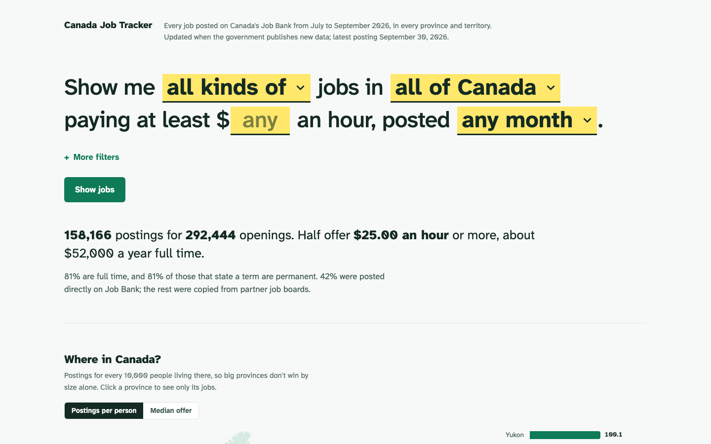
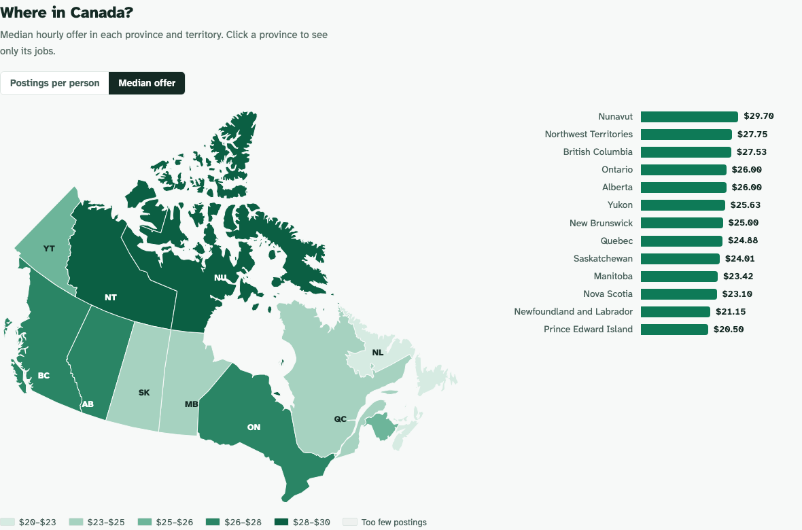
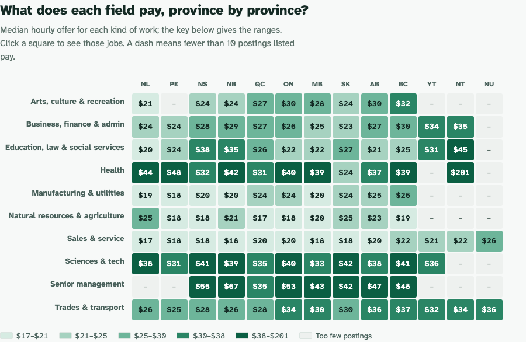
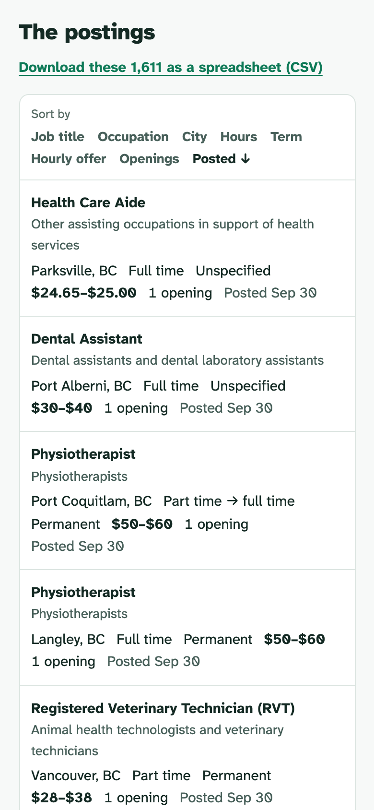

# Canada Job Tracker

**Live at https://canada-job-tracker.w2riz.workers.dev**, hosted free on Cloudflare.

A dashboard for exploring job postings across Canada: filter by province, city, occupation, offered wage, skill level, hours, term and month. Results appear as a map of Canada, a heat grid of pay by field and province, charts, and a sortable, exportable table. It also compares the postings with Statistics Canada's vacancy estimates, to show which kinds of work the postings over- or under-count.

Written in Rust. The same Rust code renders every page, including the SVG charts, in one of two places:

- **On a server** (`cargo run`). The browser gets plain HTML and CSS with **no JavaScript**.
- **As a static page**, the treemap in `static/index.html`, drawn in the browser from `data.json`. This is how the live site works: it's static files, so it costs nothing to host (see [Deploying](#deploying)). It has the layout of [karpathy/jobs](https://github.com/karpathy/jobs) and doesn't have the server's job list, map or charts.

All page state lives in the URL, so any view can be bookmarked or shared. Bars in the charts are links that apply a filter, and hovering a bar shows its numbers.



| | |
|---|---|
|  |  |



## Run it locally

You need [Rust](https://rustup.rs). The repo includes a current `data/jobs.json`, so either version works straight away.

**The server version** (plain HTML, no JavaScript):

```bash
cargo run --release
```

Then open http://localhost:8080.

**The static site**, as it runs on Cloudflare (also needs Node):

```bash
npm install
npm run build   # builds dist/: the page and data.json
npm run dev     # serves dist/ with wrangler on port 8787
```

Then open http://localhost:8787.

Settings for the server version:

| Env var | Default | |
|---|---|---|
| `PORT` | `8080` | |
| `DATA_PATH` | `data/jobs.json` | where data is loaded from and saved to |
| `MONTHS` | `3` | how many monthly Job Bank files to keep |
| `REFRESH_HOURS` | `6` | how often to check for new releases, starting 10 minutes after the server starts (`0` turns it off) |

## Data sources

All sources are official, free and need no API key.

| Source | What we use | Updated |
|---|---|---|
| [Job Postings Advertised on Canada's National Job Bank](https://open.canada.ca/data/en/dataset/ea639e28-c0fc-48bf-b5dd-b8899bd43072) (ESDC, Open Government Licence – Canada) | Every posting from the latest monthly files: title, NOC 2021 occupation, province, city, offered wage, hours, term, number of openings, first posting date | Monthly, early in the following month |
| [StatCan Job Vacancy and Wage Survey, table 14-10-0444-01](https://www150.statcan.gc.ca/t1/tbl1/en/tv.action?pid=1410044401) | Estimated vacancies and average offered hourly wage for Canada and each province/territory, by broad occupational category | Quarterly |
| [StatCan population estimates, table 17-10-0009-01](https://www150.statcan.gc.ca/t1/tbl1/en/tv.action?pid=1710000901) | Population by province/territory, for postings per 10,000 people on the map | Quarterly |
| [Natural Earth](https://www.naturalearthdata.com/) 1:50m admin-1 boundaries (public domain) | Province and territory outlines, converted once into `src/canada_map.rs` by `tools/gen_map.py` | Static |

**The data stays up to date by itself.** The server checks both sources every `REFRESH_HOURS`. When Job Bank publishes a new month or StatCan a new quarter, the server downloads it in the background and switches over without restarting. For the live site, a daily GitHub Actions job checks instead, commits any new data, and redeploys the site (see [Deploying](#deploying)).

To fetch data by hand (for example, to update the copy bundled in the repo):

```bash
cargo run --release -- fetch    # always download
cargo run --release -- update   # download only if there's something new
```

This streams about 140 MB of UTF-16 CSVs (about 158,000 postings for three months). Memory peaks around 85 MB because each file is processed as it downloads and repeated text is stored once.

**Going easy on the sources.** Checking for new data costs one request to open.canada.ca and four to StatCan's API, and the 140 MB download only happens when there's something new:

- The live site's visitors never contact these sources. Their browsers only download files from Cloudflare.
- The daily job checks once a day.
  - If the check can't reach the sources, it tries up to 3 more times, 10 minutes apart.
  - A download that fails isn't repeated until the next day.
- The server's first check waits 10 minutes after it starts. On a host that stops idle machines and starts them on the next visit, like Fly, a brief visit doesn't trigger a download.

All requests reuse connections, give up on a stalled connection after 2 minutes, and identify the project in their user agent.

### How the data is shaped

- **Category** is the NOC 2021 broad occupational category (first digit of the code). **Skill level** is the TEER category (second digit).
- **Wages** are converted to hourly: annual ÷ 2,080, daily ÷ 8, and weekly or monthly using the posting's stated hours (40 a week if none are given). Values outside $10–$300/h are treated as missing.
- **Cities** carry their province ("Richmond, BC") so same-named places stay separate. **Toronto** includes North York, Etobicoke, Scarborough, York and East York, which Job Bank reports separately.
- **Map and heat-grid colours** use quantile steps, so each shade covers about the same number of provinces or cells and one outlier can't wash out the rest. Heat-grid cells need at least 10 postings with pay.
- In memory, each posting is packed into about 40 bytes, with repeated text stored once. The server uses about 85 MB, even mid-refresh, and renders a page in 5–15 ms. In the browser, loading the dataset takes about 0.1 s on a recent laptop and each view renders in 10–25 ms.

## Tests

```bash
npm install
npx playwright install chromium   # first time only
npm test
```

`npm test` runs three things in order:

1. `cargo test`: unit tests for the Job Bank parser and wage conversion (`src/fetch.rs`), the data format (`src/data.rs`), filtering and sorting (`src/query.rs`), chart scales and colour steps (`src/charts.rs`) and the page and CSV (`src/views.rs`), using a small made-up dataset. `tests/real_data.rs` also renders several views from the bundled `data/jobs.json`. None of the tests use the network.
2. `npm run build`, so the browser tests see the current code.
3. `playwright test`: smoke tests in `e2e/smoke.spec.js` against `wrangler dev` on port 8787 (started for you, or reused if it's already running). They load the page, use the form, a chart link, the back button and the CSV download, check the empty state, check that the phone layout fits 390px, and fail on any console error.

`cargo test` and `npm run test:e2e` run either half on its own.

## Architecture

```
Job Bank CSVs + StatCan API ──fetch.rs──▶ data/jobs.json ──data.rs──▶ Dataset (in memory)
                                                                         │
                                       URL query ──query.rs──▶ filtered postings
                                                                         │
                                                       views.rs + charts.rs ──▶ HTML / CSV
```

- **Two outputs from one dataset.** `src/views.rs` turns a `Dataset` and the URL's parameters into a complete HTML page (Maud templates), and `src/charts.rs` draws the charts as HTML and inline SVG. The Axum server (`src/main.rs`) calls it for each request. The static site (`src/site.rs`) instead aggregates the last 45 days of postings into one tile per occupation, in `data.json`, and `static/index.html` draws them as a treemap in the browser.
- **The URL is the state.** Every filter, sort, page and map setting is a query parameter (`query::Params`), so the server and the browser build produce the same page for the same URL. Malformed or unknown values fall back to defaults or to "no matches" rather than errors.
- **Compact data.** `data/jobs.json` stores each text column once as a list of distinct values, with postings as rows of indexes. In memory, each posting is a ~40-byte struct, and searches compare each distinct title once rather than once per posting.
- **No database.** All of the data fits in memory, so filtering is a scan over ~158,000 postings, which takes a few milliseconds.

## Code layout

| File | |
|---|---|
| `src/main.rs` | HTTP server (Axum), routes, background refresh, and the `fetch`, `update` and `site` commands |
| `src/lib.rs` | The code shared by the server and the static site |
| `src/site.rs` | Builds the static site in `dist/`: the page and `data.json` |
| `src/fetch.rs` | Downloads and parses Job Bank and StatCan data |
| `src/data.rs` | On-disk JSON format and the compact in-memory dataset |
| `src/query.rs` | URL parameters, filtering, sorting |
| `src/views.rs` | The page (Maud templates) and CSV export |
| `src/charts.rs` | Bar charts (HTML), histograms (SVG), the Canada map and the heat grid |
| `src/regions.rs` | Provinces and territories, with each data source's codes |
| `src/canada_map.rs` | Generated province outlines (don't edit; rerun `tools/gen_map.py`) |
| `static/styles.css` | Stylesheet, built into the binary |
| `static/index.html` | Static site only: the treemap page (karpathy/jobs' styles, with this project's data) |
| `tools/build-site.sh` | Builds the static site |
| `tests/real_data.rs` | Renders views from the bundled data |
| `e2e/smoke.spec.js`, `playwright.config.js` | Browser smoke tests (Playwright) |
| `wrangler.jsonc` | Cloudflare config for the static site |
| `.github/workflows/update-data.yml` | Daily check for new data, committed to `main` |

## Deploying

### Cloudflare (the live site)

The live site, https://canada-job-tracker.w2riz.workers.dev, is static files on Cloudflare Workers. No server code runs, so it's free. `tools/build-site.sh` builds `dist/`, which contains:

- `index.html`: the treemap page (`static/index.html`)
- `data.json`: one tile per occupation for the last 45 days of postings, about 150 KB

The page fetches `data.json` and draws the treemap. Each tile's layer (median wage, wage against StatCan, full-time share or training level) is set by the buttons above it, and clicking a tile opens a Job Bank search for that occupation. Without JavaScript, the page shows only its text.

**Deploys run in GitHub Actions.** `.github/workflows/deploy-site.yml` builds the site and runs `wrangler deploy`. It runs on every push to `main` that changes the site, and after each daily data update. It needs two repository secrets: `CLOUDFLARE_API_TOKEN` (a token with Workers edit permission) and `CLOUDFLARE_ACCOUNT_ID`. You can also run it by hand from the Actions tab.

**Data updates.** A static site can't refresh itself, so `.github/workflows/update-data.yml` does it. Every day at 15:17 UTC, after StatCan's 8:30 a.m. ET releases, it runs `cargo run --release -- update`. If Job Bank or StatCan has published something new, it commits the new `data/jobs.json` to `main`. Then `deploy-site.yml` redeploys the site.

To deploy by hand instead (for example, if the GitHub workflow is failing), you need Rust, Node and a Cloudflare account:

```bash
npm install
npx wrangler login                          # first time only
npm run deploy                              # builds dist/, then uploads it
```

### Fly.io

To run the server version instead:

```bash
fly launch --copy-config --no-deploy   # first time only
fly deploy
```

`fly.toml` runs one small machine in Toronto (`yyz`) that stops when idle and starts on the next request. The Dockerfile builds a release binary into a small distroless image (no shell or package manager).

To use your own domain:

```bash
fly certs add yourdomain.ca
```

Then add the DNS records it prints at your registrar.

## Caveats

Postings measure what's advertised, not all hiring:

- **Job Bank is one slice of the market.** Employers using the Temporary Foreign Worker program must advertise there, so food service, caregiving and trades are over-represented, and tech and professional roles are under-represented. The "Postings vs. estimated vacancies" chart shows how far off each category is.
- **No employer names and no closing dates** are published, so you can't see who is hiring or tell filled jobs from open ones.
- **Partner postings** (about 60%) come from other job boards and have fewer fields filled in.
- **Jobs that are never posted** (internal fills, referrals, agency hires) don't appear anywhere. StatCan's survey counts them; postings data can't.
